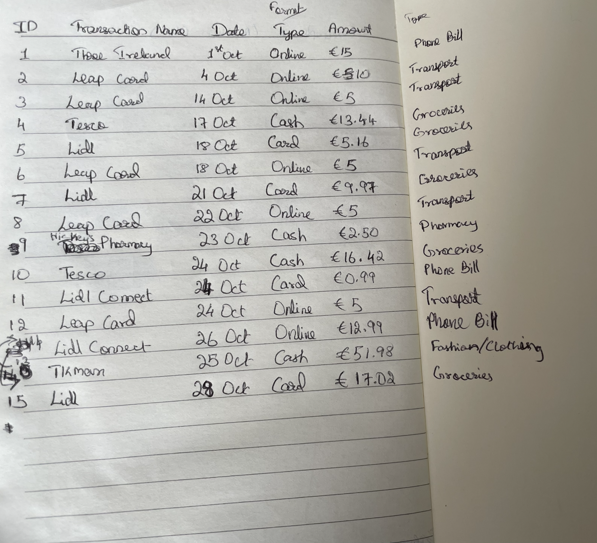

# Data-Centric-Programming-Assignment

## Description
The dataset used for this assingment records individual transactions over a period of time. Each record includes the transaction name, date, payment method, category and amount spent.

## Data Dictionary
| Feature Name | Data Type | Description |
|--------------|-----------|-------------|
| Transaction_ID | integer | Unique identification number for each transaction |
| Transaction_Name | string | Name of store where money was spent |
| Date | date | Date the transaction occured |
| Type | string | Type of the transaction (eg:- card, cash, etc.) |
| Category | string | Category of the expense |
| Amount | float | Amount spent in euros |

## Questions
Questions to be answered after analysing the data:
1. What is my average monthly spend?
2. On what category do I spend the most?

## Images

The image above shows the initial notebook used to record and organise the expenses before it was transfered to a CSV file.